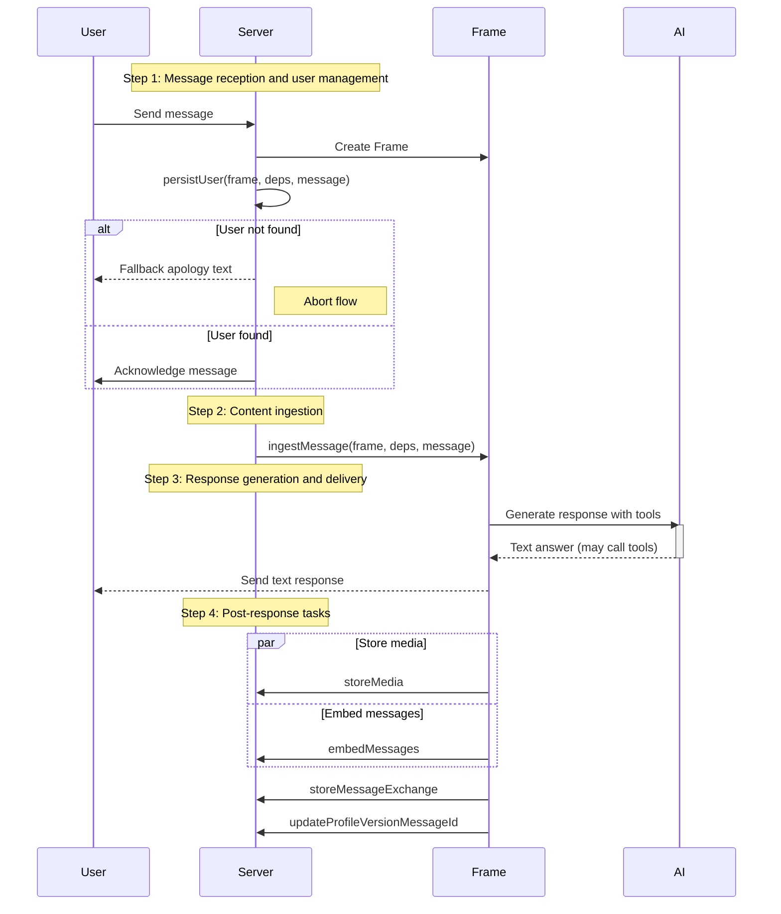
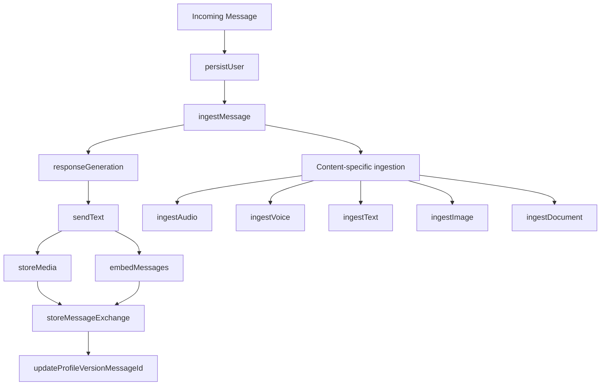
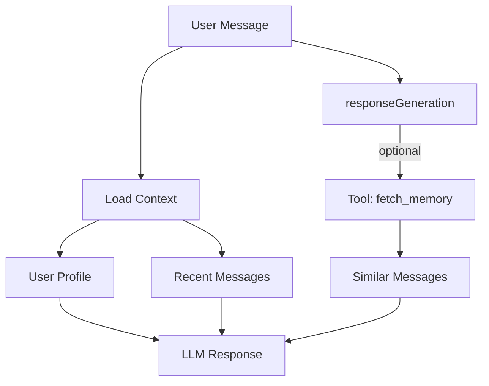
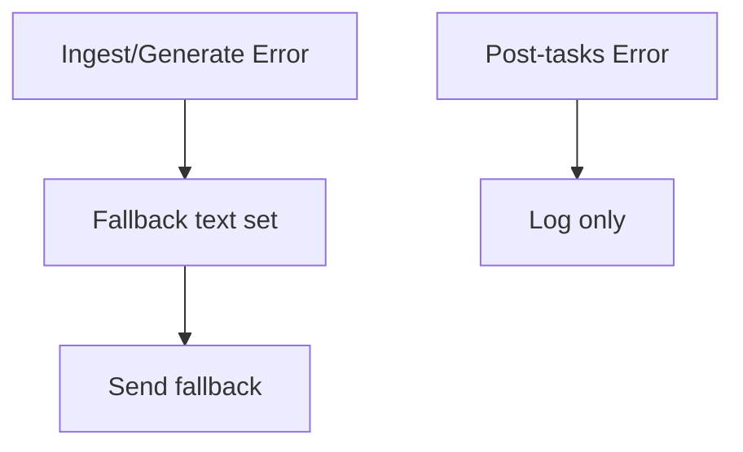

# Agent Workflow

## Purpose

Implement agent workflow that provides contextual, personalized responses using a Frame-based pipeline where small systems (functions) mutate a per-request Frame.

## Workflow Overview

The agent follows a simple, function-oriented pipeline that passes and mutates a per-request Frame:

## Architecture

### Frame-based pipeline

- **Frame**: A single per-request struct holding transient app state
- **Functions (systems)**: Small focused functions that read/write the Frame and use injected deps
- No entities or components. No registry. The Frame fields act as minimal data holders for the request lifecycle.

### System Flow

## Step-by-Step Implementation

### Step 1: Message Reception and User Management

- Parse WhatsApp webhook payload (infra/chat)
- Call persistUser(frame, deps, message) to create/update user by external ID
- Acknowledge the inbound message (deps.chat.acknowledgeMessage)
- Attach minimal inbound metadata to Frame

### Step 2: Content Ingestion

- Determine content type from message
- ingestMessage(frame, deps, message) routes to:
  - ingestText (inline)
  - ingestVoice
  - ingestAudio
  - ingestImage
  - ingestDocument
- Handles media download and processing; stores transcriptions/derived text on Frame

### Step 3: Response Generation

**responseGeneration(frame, deps)**: Generates and sends the main text response

- Context assembled as messages for the AI provider:
  - System prompt: identity, capabilities, constraints, styles, media tags, formatting (src/agent/prompts/system.ts)
  - User profile injected as a system message when present (src/agent/prompts/userProfile.ts)
  - Recent messages window + type tags [aud]/[img]/[doc:filename] (src/agent/prompts/recentMessages.ts)
  - Current inbound text or media transcription as the final user message
- Tools available to the model during this step:
  - fetch_memory: retrieve similar past messages (vector search)
  - search_files: semantic search over uploaded files
  - send_file: deliver a file using the last search results (messageId only)
  - web_search: discover current sources with Google Search via Gemini
  - web_fetch: fetch and optionally extract text from a URL
  - google_places: search places; may send map pin/contact card when flags are set
  - send_reaction: react to the user message with an emoji
  - update_user_profile: propose minimal, compliant profile improvements (see spec/features/LGPD.md; require explicit consent when applicable; never store sensitive data; keep changes minimal)
- Delivery: after tool-run completion, assistant sends a text reply; file/location/contact may already be sent by tools
- Failure policy: on error, set a polite fallback text and bubble the error up; outer agent catches and sends the fallback

### Step 4: Response Delivery and Storage

Delivery occurs inside responseGeneration (chat.sendText). After that, we run post-response systems:

- **MediaStorageSystem**: Handle file storage

  - Store media files in object storage
  - Generate storage keys
  - Link media to messages

- **EmbeddingSystem**: Generate and store embeddings

  - Create vector embeddings for inbound/outbound texts
  - Store embeddings in database
  - Enable similarity search

- **StoreMessageExchangeSystem**: Persist conversation

  - Store user and assistant messages
  - Maintain conversation history
  - Enable context retrieval

- **UpdateProfileVersionMessageId**: Link latest profile version (if updated) to the current message
  - Runs only when update_user_profile tool was used
  - Associates profileVersionId with stored exchange

Note: Profile improvements are proposed by the model via the update_user_profile tool during responseGeneration; there is no separate ImproveUserProfile system.

## Context Assembly

### Context Sources

The system assembles context from multiple sources:

1. **User Profile**: Persistent user information maintained across sessions
2. **Recent Messages**: Configurable window of recent conversation history
3. **Similar Messages**: Vector search results for semantic similarity
4. **Scheduled Reminders**: Active and upcoming reminders (future feature)

### Context Limits

- **Recent Messages**: Controlled by DB query in deps.db.findRecentMessages (window chosen in code)
- **Similar Messages**: Returned by fetch_memory tool; excludes very recent ids to avoid duplication
- **Token Budget**: Keep prompts concise; system prompt enforces <2000 chars replies
- **Deduplication**: Implicit via excluding recent ids and tagging; future enhancements may add explicit dedupe

### Context Assembly Process

## Error Handling

We isolate errors in three segments aligned with the code in src/agent.ts:

1. Response flow (ingestMessage + responseGeneration)

- On failure: log; set polite fallback outbound text; send fallback immediately

2. Delivery is part of responseGeneration; if it throws, the catch above handles fallback

3. Post-response tasks (storeMedia, embedMessages, storeMessageExchange, updateProfileVersionMessageId)

- Run in best-effort mode; failures are logged and do not affect user experience

## Integration Points

### Memory System Integration

- **EmbeddingSystem**: Generates and stores vector embeddings
- **Vector Search**: Retrieves similar messages for context
- **Context Assembly**: Combines multiple context sources

### Database Integration

- **User Persistence**: Maintains user profiles and state
- **Message Storage**: Stores conversation history
- **Embedding Storage**: Enables similarity search

### WhatsApp Integration

- **Message Reception**: Processes incoming webhooks
- **Response Delivery**: Sends messages to users
- **Media Handling**: Downloads and stores media files

### AI Provider Integration

- **Text Generation**: Creates contextual responses
- **Audio Transcription**: Converts voice to text
- **Image Analysis**: Describes visual content
- **Document Processing**: Extracts text from documents

## Success Metrics

- **Context Relevance**: Appropriate context retrieved for user queries
- **Response Quality**: Contextual and personalized responses
- **Performance**: End-to-end response time <3 seconds
- **Error Recovery**: Graceful handling of failures
- **Memory Effectiveness**: Accurate similarity search results
- **User Experience**: Seamless multi-modal interactions
