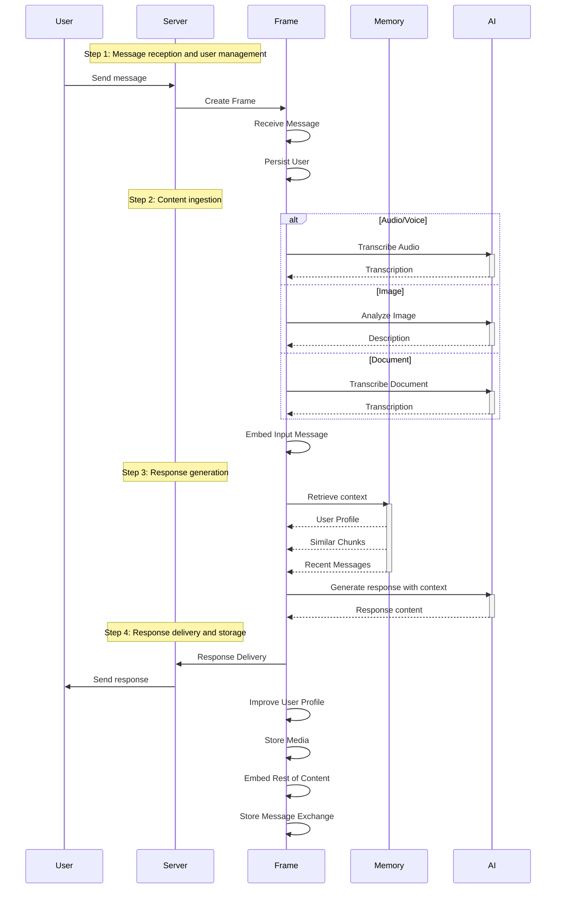
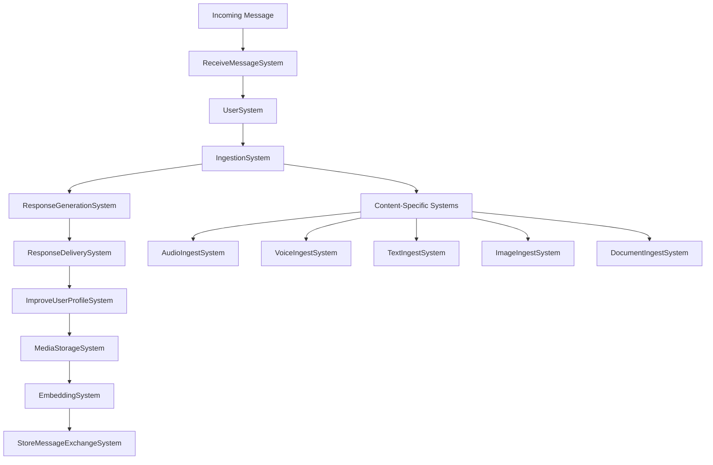
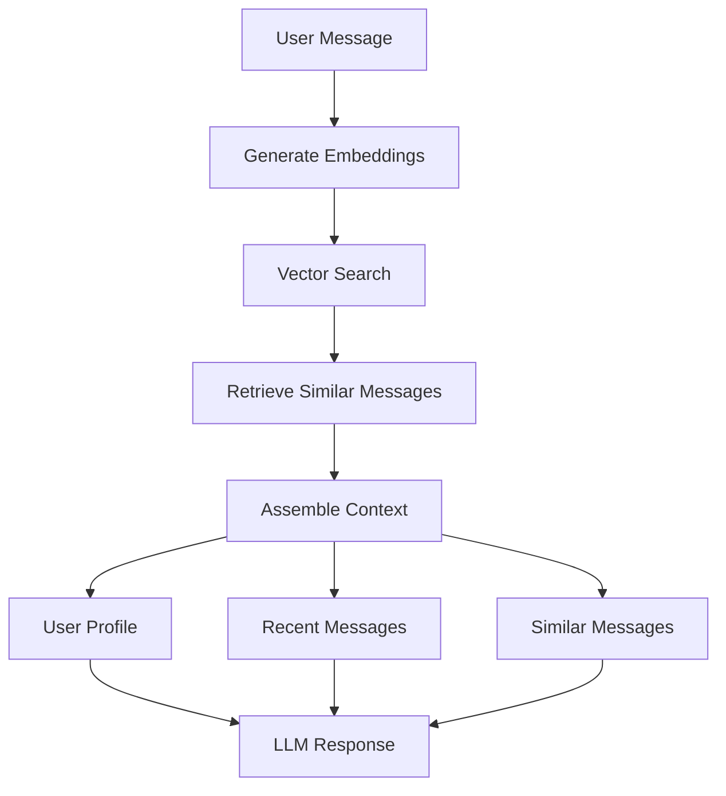
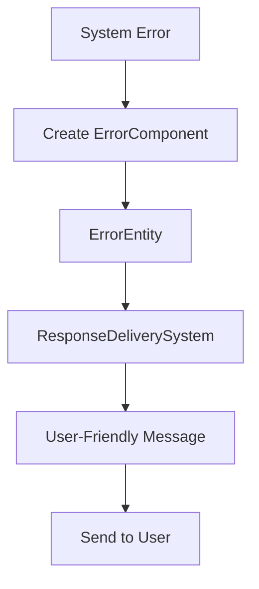

# Agent Workflow

## Purpose

Implement agent workflow that provides contextual, personalized responses using an Entity-Component-System (ECS) architecture with specialized systems for different concerns.

## Workflow Overview

The agent follows a systematic ECS-based approach to handle each incoming message:

## ECS Architecture

### Frame Management

The agent uses a Frame-based ECS architecture:

- **Frame**: Central entity manager with component storage
- **Entities**: Message entities with various components
- **Systems**: Specialized processors for different concerns
- **Components**: Data-only structures for entity state

### System Flow

## Step-by-Step Implementation

### Step 1: Message Reception and User Management

**ReceiveMessageSystem**: Processes incoming webhook payload

- Parse WhatsApp webhook payload
- Create message entity with appropriate components
- Extract user information and message content
- Handle different message types (text, media, etc.)

**UserSystem**: Manages user persistence

- Create or update user from external ID
- Maintain user profile information
- Handle user state across sessions

### Step 2: Content Ingestion

**IngestionSystem**: Routes messages to appropriate processors

- Determine content type from message
- Route to specialized ingestion systems
- Handle media download and processing

**Specialized Ingestion Systems**:

- **TextIngestSystem**: Process text messages directly
- **VoiceIngestSystem**: Transcribe voice recordings
- **AudioIngestSystem**: Process audio files with system messages
- **ImageIngestSystem**: Analyze images and generate descriptions
- **DocumentIngestSystem**: Extract text from documents

### Step 3: Response Generation

**ResponseGenerationSystem**: Generate contextual responses

- Assemble context from multiple sources:
  - User profile (persistent information)
  - Recent messages (configurable window)
  - Similar messages (vector search results)
  - Scheduled reminders (future feature)
- Generate AI response with full context
- Handle tool calls and integrations

### Step 4: Response Delivery and Storage

**ResponseDeliverySystem**: Send responses to user

- Format response for WhatsApp
- Send message via WhatsApp API
- Handle delivery confirmation

**ImproveUserProfileSystem**: Update user profile

- Analyze user interactions
- Update persistent profile information
- Maintain user preferences and context

**MediaStorageSystem**: Handle file storage

- Store media files in object storage
- Generate storage keys
- Link media to messages

**EmbeddingSystem**: Generate and store embeddings

- Create vector embeddings for all content
- Store embeddings in database
- Enable similarity search

**StoreMessageExchangeSystem**: Persist conversation

- Store user and assistant messages
- Maintain conversation history
- Enable context retrieval

## Context Assembly

### Context Sources

The system assembles context from multiple sources:

1. **User Profile**: Persistent user information maintained across sessions
2. **Recent Messages**: Configurable window of recent conversation history
3. **Similar Messages**: Vector search results for semantic similarity
4. **Scheduled Reminders**: Active and upcoming reminders (future feature)

### Context Limits

- **Recent Messages**: Configurable via `MAX_RECENT_MESSAGES` environment variable
- **Similar Messages**: Configurable via `MAX_SIMILAR_MESSAGES` environment variable
- **Token Budget**: 64k maximum prompt tokens per request
- **Deduplication**: Remove duplicate content between different context sources

### Context Assembly Process

## Error Handling

The ECS architecture provides robust error handling:

### Error Components

- **ErrorComponent**: Captures error state in entities
- **Error Delivery**: Converts error components to user-friendly messages
- **Graceful Degradation**: Continues processing even with partial failures

### Error Flow

## Integration Points

### Memory System Integration

- **EmbeddingSystem**: Generates and stores vector embeddings
- **Vector Search**: Retrieves similar messages for context
- **Context Assembly**: Combines multiple context sources

### Database Integration

- **User Persistence**: Maintains user profiles and state
- **Message Storage**: Stores conversation history
- **Embedding Storage**: Enables similarity search

### WhatsApp Integration

- **Message Reception**: Processes incoming webhooks
- **Response Delivery**: Sends messages to users
- **Media Handling**: Downloads and stores media files

### AI Provider Integration

- **Text Generation**: Creates contextual responses
- **Audio Transcription**: Converts voice to text
- **Image Analysis**: Describes visual content
- **Document Processing**: Extracts text from documents

## Success Metrics

- **Context Relevance**: Appropriate context retrieved for user queries
- **Response Quality**: Contextual and personalized responses
- **Performance**: End-to-end response time <3 seconds
- **Error Recovery**: Graceful handling of failures
- **Memory Effectiveness**: Accurate similarity search results
- **User Experience**: Seamless multi-modal interactions
