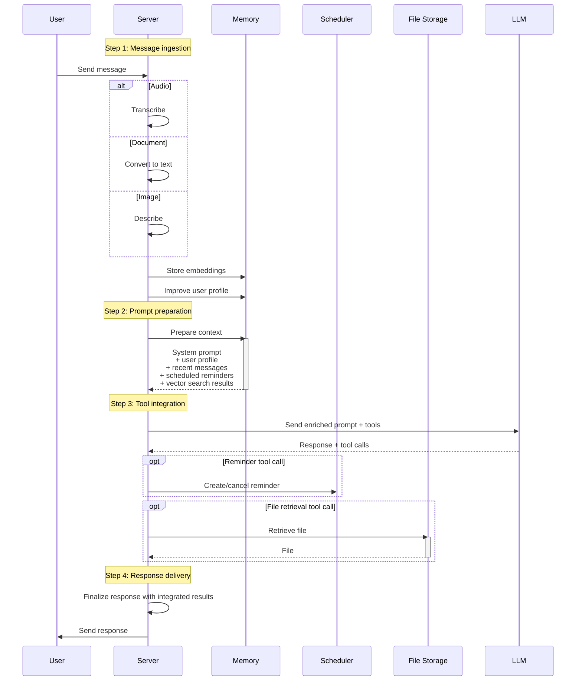
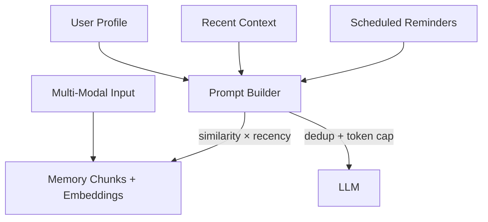
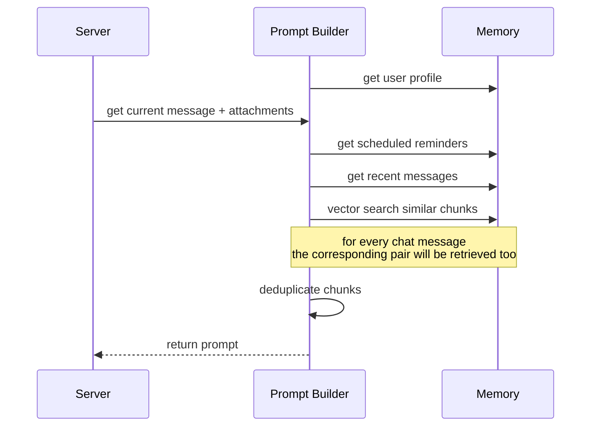

# Agent Workflow

## Purpose

Implement agent workflow that provides contextual, personalized responses by orchestrating context retrieval before generating responses.

## Workflow Overview

The agent follows a systematic approach to handle each incoming message:

## Step-by-Step Implementation

### Step 1: Message Ingestion

**Responsibility:** Initial message processing and storage

- Receive webhook payload from WhatsApp
- Parse message content and metadata
- Store raw message for processing
- Route to appropriate content handler
- Handle content-specific processing (e.g., audio transcription, document parsing, image analysis)
- Store and embed processed content chunks in vector store

### Step 2: Prompt Preparation and Context Orchestration

Responsibility: Prepare base prompt structure with placeholders and coordinate context retrieval and assembly

- Load base system prompt template
- Prepare placeholders for dynamic content:
  - `{{ user_profile }}` - User's persistent profile
  - `{{ recent_messages }}` - Recent conversation history
  - `{{ memory }}` - Retrieved similar content
  - `{{ schedule }}` - Relevant reminders

Implementation:

- Manages context assembly from multiple sources
- Handles deduplication and token budget management
- Returns composed context for prompt enrichment

Context Sources:

- User profile (persistent user information)
- Recent conversation history
- Vector search results for similar content (can be messages or files)
- Scheduled reminders

#### Conceptual Layers

**Memory Chunks**

- Core content with embeddings
- Flexible source metadata supporting multiple content types
- User isolation and timestamp tracking
- Extensible structure for future content types

**Context Sources**

- User profiles (maintained and updated by LLM)
- Recent message history (configurable window)
- Scheduled reminders (active and upcoming)
- File references (documents, images with summaries)
- Vector search results (similarity-based retrieval)

#### Runtime Flow

#### Configuration Parameters

**Content Processing**

- Text chunking strategy
  - Filter out deleted messages, stickers, captions, etc.
- Document parsing configuration:
  - `pdf.js` for native PDF text (fast, semantic preservation)
  - `tesseract.js` OCR threshold (e.g., <50 chars from Phase 1 = trigger OCR)
  - GPT-4o-mini fallback (for OCR accuracy <80% or complex layouts)
  - Semantic chunking post-extraction (as in supermemory)
  - Max chunk size
- Fast image analysis model
- Audio transcription service
  - double speed before transcribing
  - whisper-1
- User profile update frequency and scope

**Retrieval Settings**

- Recent message window size (e.g., last 1 week)
- Vector search top-K (e.g., 15-30 similar chunks before deduplication)
- Similarity threshold for deduplication (e.g., cosine distance < 0.1)
- 64k maximum prompt token budget per request

**Memory Management**

- Embedding model consistency
- Archival policies for old content
- Storage optimization strategies
- Cross-user isolation enforcement

### Step 3: Tool Integration

**Responsibility:** Enable tool usage and execute tool calls

**Available Tools:**

- `create_reminder` - Schedule new reminders
- `cancel_reminder` - Cancel existing reminders
- `retrieve_file` - Access and return stored files

Note: Web search is managed directly by the LLM provider.

**Process:**

1. Prepare tool definitions for LLM
2. Send enriched prompt with available tools to LLM
3. Receive response and potential tool calls
4. Execute scheduler-related tool calls (create/cancel reminder)
5. Execute file retrieval calls and integrate retrieved files into response
6. Integrate tool results into final response

### Step 4: Response Delivery

**Responsibility:** Finalize and send response to user

- Process tool call results
- Generate final response content
- Send response via WhatsApp
- Store assistant response for future context

## Integration Points

**Memory System Integration**

- Delegates context retrieval to memory system
- Receives assembled context respecting token budgets
- No direct vector search or embedding logic in workflow

**Scheduler Integration**

- Handles reminder creation and cancellation
- Abstracts scheduling logic from workflow

**File Storage Integration**

- Handles file retrieval from object storage
- Integrates retrieved files into responses
- Abstracts storage details from workflow

**LLM Provider Integration**

- Manages model selection and configuration
- Handles function calling and tool integration
- Processes enriched prompts with full context
- Manages web search tool directly

## Success Metrics

- **Context Relevance:** Appropriate context retrieved for user queries
- **Tool Usage Success:** Successful execution of reminder and file operations
- **Response Quality:** Contextual and personalized responses
- **Performance:** End-to-end response time <3 seconds
- **Token Efficiency:** Optimal context without exceeding budgets
