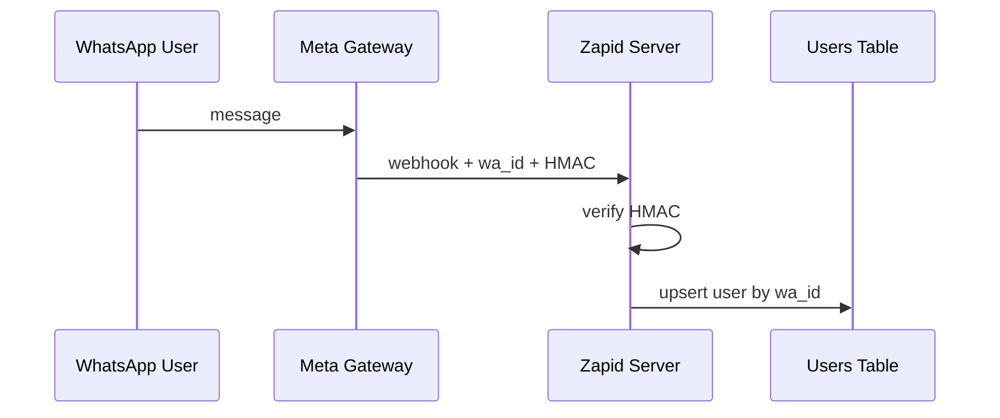
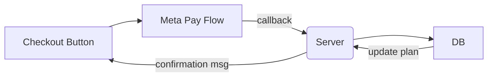

# Identity, Authorization & Payments

_Last updated: <!-- YYYY-MM-DD -->2025-06-30_

## Goals

1. Reliably map each incoming WhatsApp message to a unique user.
2. Enforce per-user feature/usage limits.
3. Offer paid tiers using Meta/WhatsApp Pay.

## Identity

- **Primary Key:** `wa_id` (WhatsApp phone number).
- **User Table:**
  - `wa_id` string PK
  - `name` string
  - `phone_number` string
  - `created_at` datetime
  - `plan` enum(free, pro, enterprise)
  - `status` enum(active, delinquent, blocked)

_No password storage required; WhatsApp itself authenticates the sender._

### External Touchpoints

## Authorization & Feature Limits

| Plan | Daily GPT Tokens | Storage Quota | Reminders | Priority |
| ---- | ---------------- | ------------- | --------- | -------- |
| Free | 10k              | 100 MB        | 10        | Low      |
| Pro  | 100k             | 2 GB          | 100       | High     |

Limits enforced by a middleware that increments counters in KV store.

## Payments (Meta/WhatsApp Pay)

1. Send a `payment_request` interactive message containing order amount and reference.
2. User confirms in-chat; Meta returns a payment_callback to our webhook.
3. On success, upgrade `plan` column and reset usage counters.
4. Invoice PDF emailed via Postmark.

### Decisions To Be Made

1. **Plan catalogue** – exact quotas & pricing.
2. **Retry strategy** – what if payment callback fails?
3. **Grace period** – how long until downgrade after failed renewal?
4. **Add-ons** – one-off memory boosts vs. subscription only.

_Trade-offs and price modelling come next._
