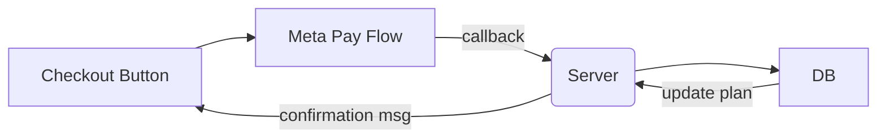

# Identity, Authorization & Payments

## Goals

1. Reliably map each incoming WhatsApp message to a unique user.
2. Enforce per-user feature/usage limits.
3. Offer paid tiers using Meta/WhatsApp Pay.

_No password storage required; WhatsApp itself authenticates the sender._

## Plans

| Feature                           | Free                           | Basic                            | Pro                                                                              |
| --------------------------------- | ------------------------------ | -------------------------------- | -------------------------------------------------------------------------------- |
| **Model**                         | GPT-5-nano Open source mdel | GPT-5-mini                       | Can choose model                                                                 |
| **Messages**                      | x/day                          | 100x/day                         | ∞                                                                                |
| **Memory** Profile Messages | ✗                              | ✓                                | ✓                                                                                |
| **Media Ingestion**               | ✗                              | Audio, voice, image and document | Video                                                                            |
| **Files**                         | ✗                              | Store and retrieve files         | Integrates with external drive (Google Drive, Microsoft OneDrive, Dropbox, etc.) |
| **Tools**                         | ✗                              | Web search Google Places      | Gmail integration                                                                |

Limits enforced by a middleware that increments counters in KV store.

## Payments (Meta/WhatsApp Pay)

1. Send a `payment_request` interactive message containing order amount and reference.
2. User confirms in-chat; Meta returns a payment_callback to our webhook.
3. On success, upgrade `plan` column and reset usage counters.
4. Invoice PDF emailed via Postmark.

### Decisions To Be Made

1. **Plan catalogue** – exact quotas & pricing.
2. **Retry strategy** – what if payment callback fails?
3. **Grace period** – how long until downgrade after failed renewal?
4. **Add-ons** – one-off memory boosts vs. subscription only.
