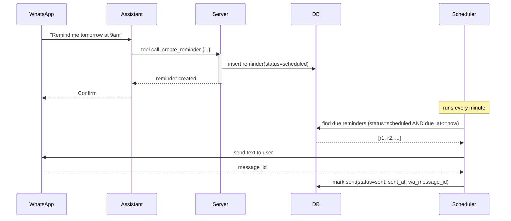

# Scheduling

## Status

- Proposed only. Not yet implemented in the agent's toolset; create/cancel/list tools are not wired. Use this doc as a plan/spec.

## Goals

- Allow users to schedule minute-precision reminders via natural language.
- Persist reminders and deliver them reliably at due time.
- Let users list and cancel reminders.
- Provide clear AI tool contracts for scheduling.
- Respect per-plan limits (max reminders, quotas) and WhatsApp messaging constraints (24h window vs template).

## User Scenarios

1. Create reminder

- User: "Remind me about this tomorrow at 9am"
- Assistant calls create_reminder(date, time, description, message)
- Backend stores reminder and replies with confirmation including a reminder_id

2. List reminders

- User: "What are my reminders?"
- Assistant lists upcoming active reminders (from schedule context or via list tool)

3. Cancel reminder

- User: "Cancel the 9am reminder"
- Assistant shows matching items if ambiguous, then calls cancel_reminder(reminder_id)

4. Delivery

- At due time, scheduler sends the reminder message to the same WhatsApp user.

## High-level Flow

## Data Model (proposed)

Table: reminder

- id TEXT PK (UUIDv7)
- user_id TEXT NOT NULL (FK user.id)
- status TEXT NOT NULL CHECK(status IN ('scheduled','sending','sent','cancelled','failed'))
- due_at DATETIME NOT NULL
- timezone TEXT NOT NULL // IANA (e.g., "America/Sao_Paulo")
- description TEXT NOT NULL // for context/retrieval; short
- message TEXT NOT NULL // what we will send at due time
- created_at DATETIME DEFAULT CURRENT_TIMESTAMP
- updated_at DATETIME
- sent_at DATETIME
- wa_message_id TEXT
- error TEXT // nullable; last error string if failed
- recurrence_cron TEXT NULL // optional, future; empty for MVP

Indexes

- IDX_reminder_due_status ON (status, due_at)
- IDX_reminder_user ON (user_id, status)

Retention

- Keep cancelled/sent for 30 days (for audit and UX). Periodic cleanup job may hard-delete old rows.

Idempotency & concurrency

- Scheduler marks a batch as status='sending' in a single statement that returns affected rows to avoid double-send when multiple schedulers run.

## Time & Locale Rules

- Store due_at in UTC; store timezone separately.
- The assistant must resolve relative dates like "tomorrow" using the user's timezone.
- Time strings must be HH:MM (24h). Example: 09:00, 18:30.
- The user’s timezone must be known (get in onboarding).
- If a parsed time is in the past for today, schedule for the next valid day or ask for confirmation (LLM decides per prompt rules).

## Limits & Plans

- Enforce PLANS[plan].max_reminders on creation.
- Prevent creation if the user has reached the limit; assistant should reply with a concise explanation and suggest upgrading when appropriate.
- Large batches: the scheduler sends at most N per minute per user to avoid rate spikes (configurable).

## WhatsApp Policy & Delivery

- Add chat.sendTemplateMessage(to, template_name, variables) and a template catalogue for reminder delivery.

Context needed to send proactively

- chatWhatsapp.ts currently reads businessPhoneNumberId and userWhatsappId from getContext(). For scheduled sends (no inbound webhook), the scheduler must set:
  - getContext().set('businessPhoneNumberId', WA_BUSINESS_PHONE_ID)
  - getContext().set('userWhatsappId', user.externalId)
- Add WA_BUSINESS_PHONE_ID to env; fallback to metadata captured from recent inbound if stored per-installation.

## AI Tool

### 1) create_reminder

Template: src/prompts/functions/create_reminder.json

Parameters

- date: string (YYYY-MM-DD)
- time: string (HH:MM)
- description: string (short, helps find/cancel later)
- message: string (what will be sent at due time)

LLM rules

- Always disambiguate: if date/time missing or ambiguous, ask a follow-up before calling the tool.
- Use the user’s timezone when resolving relative dates.
- Keep description concise; keep message user-facing.
- After successful creation, reply with a confirmation that includes a stable reminder_id returned by the backend.

Backend behavior

- Validate plan limits.
- Parse date+time with timezone -> due_at.
- Insert reminder(status=scheduled) and return reminder_id.

### 2) cancel_reminder

Template: src/prompts/functions/cancel_reminder.json

Spec

- parameters.properties.reminder_id: string
- parameters.required: ["reminder_id"]

LLM rules

- If the user doesn’t specify an ID, list likely matches (by fuzzy match on description and due time) and ask the user to pick one; only then call cancel_reminder.

Backend behavior

- Set status='cancelled' when not already sent/cancelled; return success=false if not found or already terminal.

### 3) list_reminders

Template: src/prompts/functions/list_reminders.json

Purpose

- Allow the model to explicitly list active upcoming reminders when asked.

Parameters

- none

Return shape (backend to LLM)

- Array of { reminder_id, due_at_local, description, message }

## Scheduler Service (Cron)

Trigger

- Runs every minute.

Algorithm

- Select due reminders in a single atomic step:
  - UPDATE reminder SET status='sending' WHERE status='scheduled' AND due_at <= now() LIMIT :batch RETURNING id, user_id, message
- For each returned row:
  - Load user.externalId and (optional) user.name
  - Set getContext business/user ids for WhatsApp send
  - Send text message (respect 24h rule or templates)
  - On success: set status='sent', sent_at=now(), wa_message_id=...
  - On failure: set status='failed' and store error; keep retry policy simple (manual or next run with backoff)

Configuration

- SCHEDULER_POLL_INTERVAL_MS (default 60_000)
- SCHEDULER_BATCH_SIZE (default 100)
- DEFAULT_TIMEZONE (default "America/Sao_Paulo")
- WA_BUSINESS_PHONE_ID (required for proactive sends)

Edge cases

- Past-due after downtime: send immediately with a short apology suffix (optional) if late > X minutes.
- Duplicate sends: avoided by status transition scheduled->sending in a single statement.
- Recurring reminders: out of MVP; later: compute next occurrence and keep a parent row.

## DB Interface (proposed additions)

Add to src/infra/db.ts (DB interface)

- createReminder(params): Promise<{ id: string }>
- cancelReminder({ id }): Promise<{ success: boolean }>
- listUpcomingReminders({ userId, limit }): Promise<Array<{ id, dueAt: Date, timezone: string, description: string, message: string }>>
- takeDueReminders({ now, limit }): Promise<Array<{ id, userId: string, message: string }>> // transitions to 'sending'
- markReminderSent({ id, waMessageId }): Promise<void>
- markReminderFailed({ id, error }): Promise<void>

Add matching implementations to src/infra/dbLibSql.ts and a new SQL file infra/dbSetup/reminder.sql.

## Assistant Replies (UX)

Confirmation on create

- "Ok! I'll remind you on 2025-09-17 at 09:00. id: rmd_8f..."

On list

- Show up to 10 entries with local time; if none: "You have no active reminders."

On cancel

- "Cancelled reminder rmd_8f..."

Late delivery (optional)

- "Reminder: drink water (12 min late)"

## Testing Plan

- Unit: DB transitions (scheduled -> sending -> sent/cancelled/failed) and idempotency.
- Unit: listUpcomingReminders ordering and limit.
- Integration: scheduler picks up due reminders and calls chat; mock Chat to record payload and emulate failures.

## Open Decisions

- Should we store and reuse businessPhoneNumberId per installation vs. env?
- Template strategy for outside-24h reminder messages; which template names and locales?
- Add snooze_reminder tool?
- Support recurring rules (RRULE/cron) or keep one-off for MVP?

## Action Items

1. Add reminder.sql and DB methods listed above.
2. Implement Scheduler service (cron runner) with WA business/user context injection.
3. Add list_reminders tool.
4. Add tests as described.
