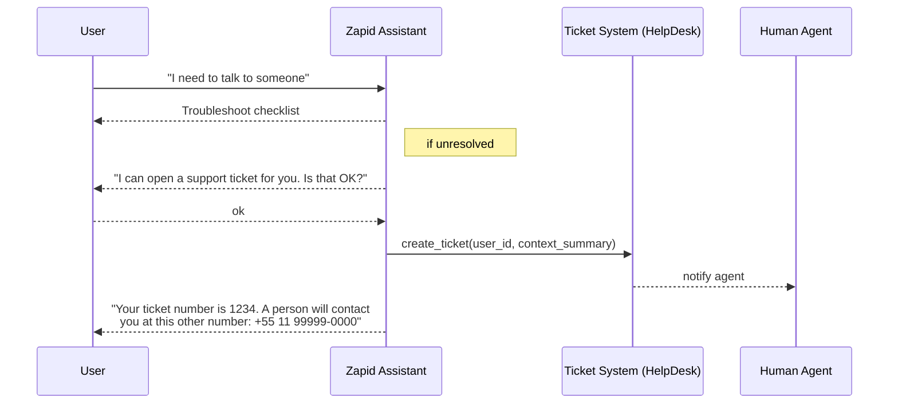

# Support & Escalation Flow

## Principles

1. The assistant remains the sole speaker in the main WhatsApp chat.
2. When human help is required, the user is redirected — not merged — into another channel.
3. Support conversations are logged separately for compliance and analytics.

## Flow Overview

## Implementation Notes

- **Trigger Intents** – Natural-language classifier looks for escalation keywords ("talk to someone", "support", "complaint").
- **Ticket Payload** – Send user id, last 20 messages, segment summary, and device meta.
- **Fallback Phone** – A dedicated WhatsApp Business number staffed by agents; messages there are NOT processed by the AI.

## Decisions To Be Made

1. **Help-desk platform** – Zendesk vs. Freshdesk vs. custom.
2. **SLA tiers** – map to the subscription plans defined in identity doc.
3. **Data retention** – how long to store ticket data separately from chat logs.
