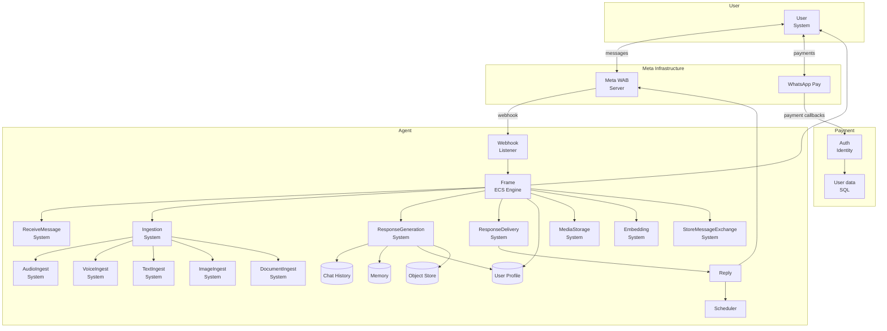
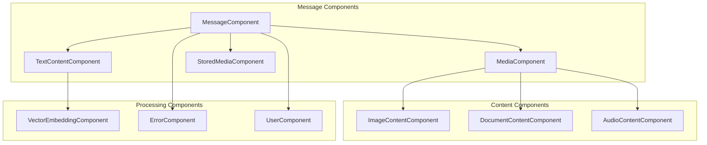
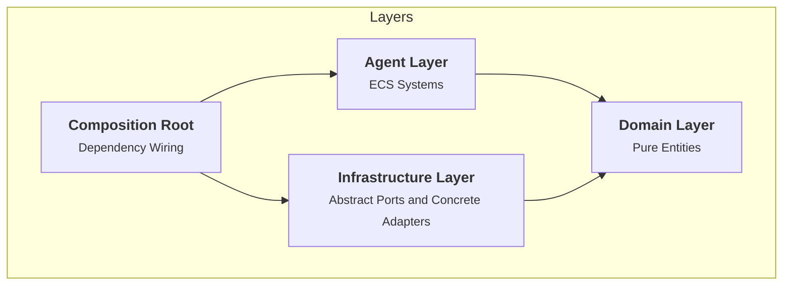

# System Patterns

## System Architecture

The system is a WhatsApp-based AI agent that processes multi-modal messages (text, audio, images, documents) and provides intelligent responses with memory, context, and tool capabilities. The architecture follows an **Entity-Component-System (ECS)** pattern with four main layers:

1. **User Layer**: WhatsApp interface
2. **Meta Infrastructure**: Meta WAB Server and WhatsApp Pay
3. **Payment Layer**: Auth/Identity system with SQL user data storage
4. **Agent Layer**: ECS-based processing engine with specialized systems for different concerns

## Key Patterns

- **Entity-Component-System Architecture:** Component-based entities with specialized systems for different concerns
- **Multi-Modal Processing:** Unified handling of text, audio, images, and documents through specialized ingestion systems
- **Context Orchestration:** Intelligent assembly of user profile, memory, chat history, and reminders
- **Persistent Storage:** Distributed storage across Chat History, Memory (vector), User Profile, and Object Store
- **Bi-directional Communication:** Inbound webhook processing and outbound reply delivery
- **Scheduled Operations:** Cron-based scheduler for reminder delivery

## ECS Architecture

The system uses an Entity-Component-System pattern for better separation of concerns, testability, and extensibility:

### Core Components

- **Frame**: Central ECS engine managing entities and components
- **Components**: Data-only structures (Message, TextContent, Media, User, etc.)
- **Systems**: Logic processors that operate on entities with specific components

### Key Systems

- **ReceiveMessageSystem**: Processes incoming webhook messages
- **UserSystem**: Manages user creation and persistence
- **IngestionSystem**: Routes messages to appropriate content processors
- **ResponseGenerationSystem**: Generates AI responses with context
- **ResponseDeliverySystem**: Sends responses via WhatsApp
- **EmbeddingSystem**: Generates and stores vector embeddings
- **MediaStorageSystem**: Handles file storage and retrieval

### Component Types

## Code Architecture

The codebase follows Domain-Driven Design principles with unidirectional dependencies to ensure maintainability, testability, and extensibility. The architecture uses **parameter injection** for dependency management without external DI libraries.

### Layered Structure

- **Domain Layer** (`src/domain/`): Pure entities and types with no external dependencies
- **Agent Layer** (`src/agent/`): ECS-based processing with systems and components
- **Infrastructure Layer** (`src/infra/`): Concrete implementations of external services (WhatsApp, DB, AI, Storage)
- **Composition Root** (`src/index.ts`): Application startup and wires concrete infrastructure to features at runtime

### Dependency Flow

## Database Schema

The database uses LibSQL with native vector support:

### Core Tables

- **user**: User profiles with external IDs and persistent profiles
- **message**: Message metadata with media storage keys
- **embedding**: Vector embeddings with content chunks
- **raw_incoming_message**: Raw webhook payloads for debugging

### Vector Support

- Native FLOAT32(384) vector type for embeddings
- Efficient similarity search using cosine distance
- Proper indexing for performance

## Error Handling

The ECS architecture provides robust error handling:

- **Error Components**: Capture error state in entities
- **Error Delivery**: Convert error components to user-friendly messages
- **Graceful Degradation**: Continue processing even with partial failures
- **Isolation**: Errors in one system don't affect others
