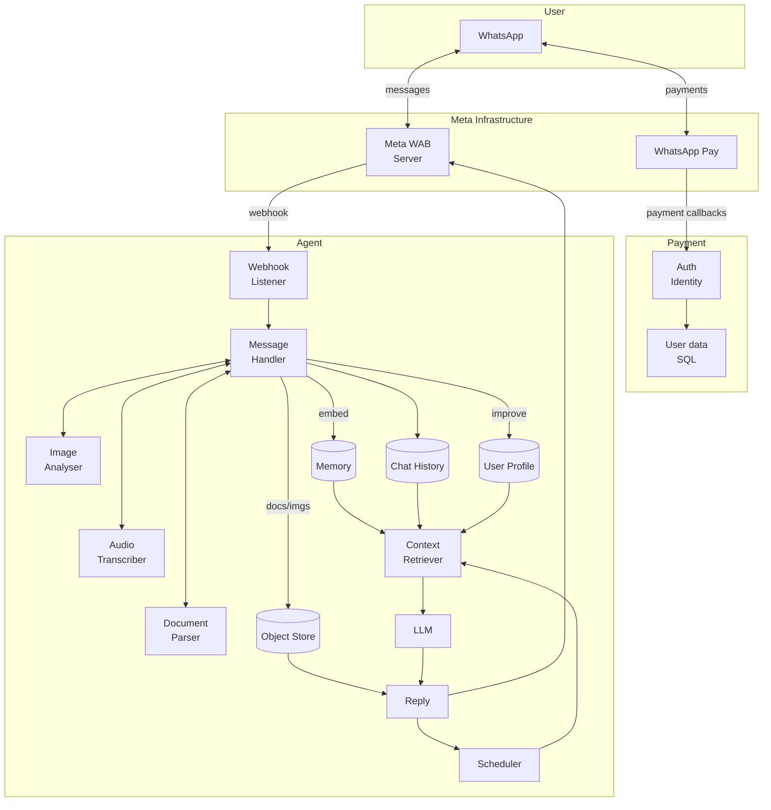

# System Patterns

## Architectural Overview

The system is a WhatsApp-based AI agent that processes multi-modal messages (text, audio, images, documents) and provides intelligent responses with memory, context, and tool capabilities. The architecture consists of four main layers:

1. **User Layer**: WhatsApp interface
2. **Meta Infrastructure**: Meta WAB Server and WhatsApp Pay
3. **Payment Layer**: Auth/Identity system with SQL user data storage
4. **Agent Layer**: Core processing engine with message handling, storage, and AI capabilities

## Key Patterns

- **Event-Driven Architecture:** Webhook-triggered processing from Meta WAB Server
- **Multi-Modal Processing:** Unified handling of text, audio, images, and documents through specialized processors
- **Context Orchestration:** Intelligent assembly of user profile, memory, chat history, and reminders
- **Persistent Storage:** Distributed storage across Chat History, Memory (vector), User Profile, and Object Store
- **Bi-directional Communication:** Inbound webhook processing and outbound reply delivery
- **Scheduled Operations:** Cron-based scheduler for reminder delivery

